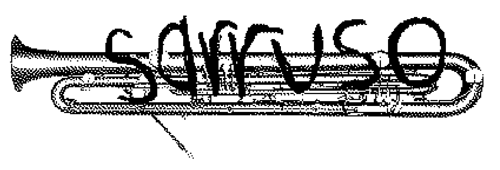

# sarruso
Dev on an ultimate voice-to-everything tool
### whats going on with the name?
I wanted to make it some kind of woodwind or brass, sarrusophone is an obscure one > sarruso
also nobody uses this name and the domains are all available

[wikipedia](https://en.wikipedia.org/wiki/Sarrusophone)

sackbut was a close second

## Requirements for this tool
- Needs to be free, zero cost, ever, i swear if this thing costs a cent i will blow up.
- needs to understand things correctly
- needs to be fully offline-able
- needs to accept basic commands alongside dictation. for exmaple: "start a note in my dream journal folder"
- needs to be so fast its crazy.
- needs to be small, super small.
